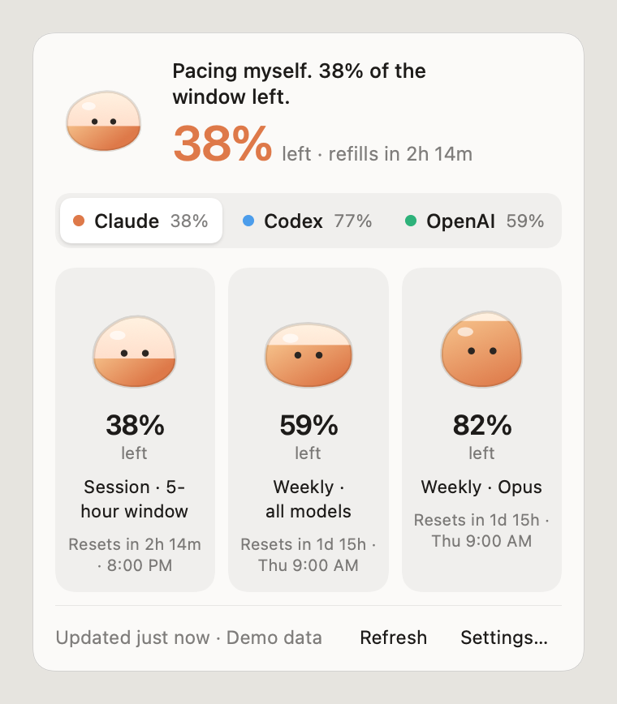
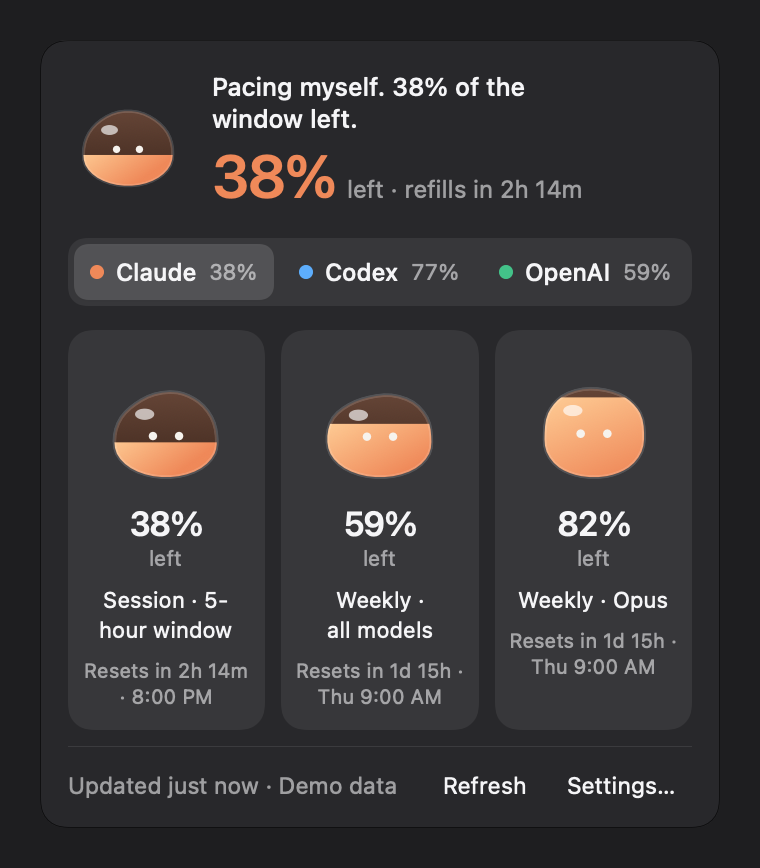
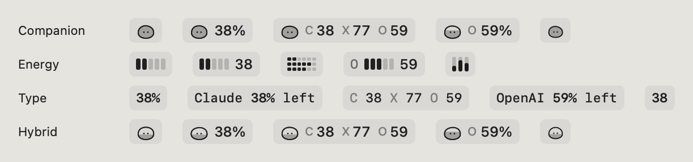
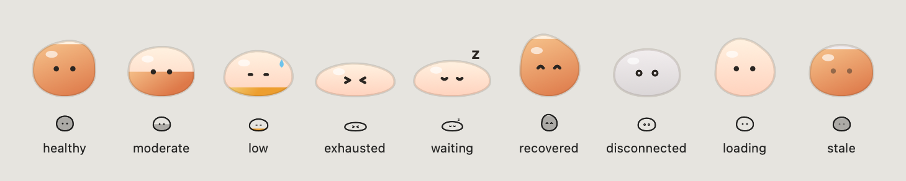
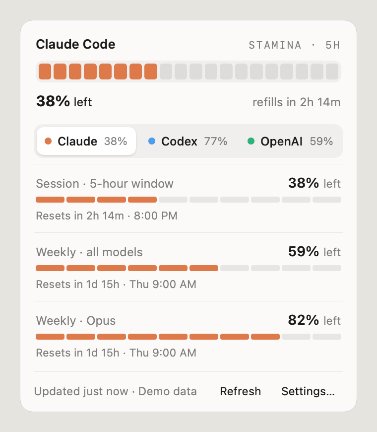
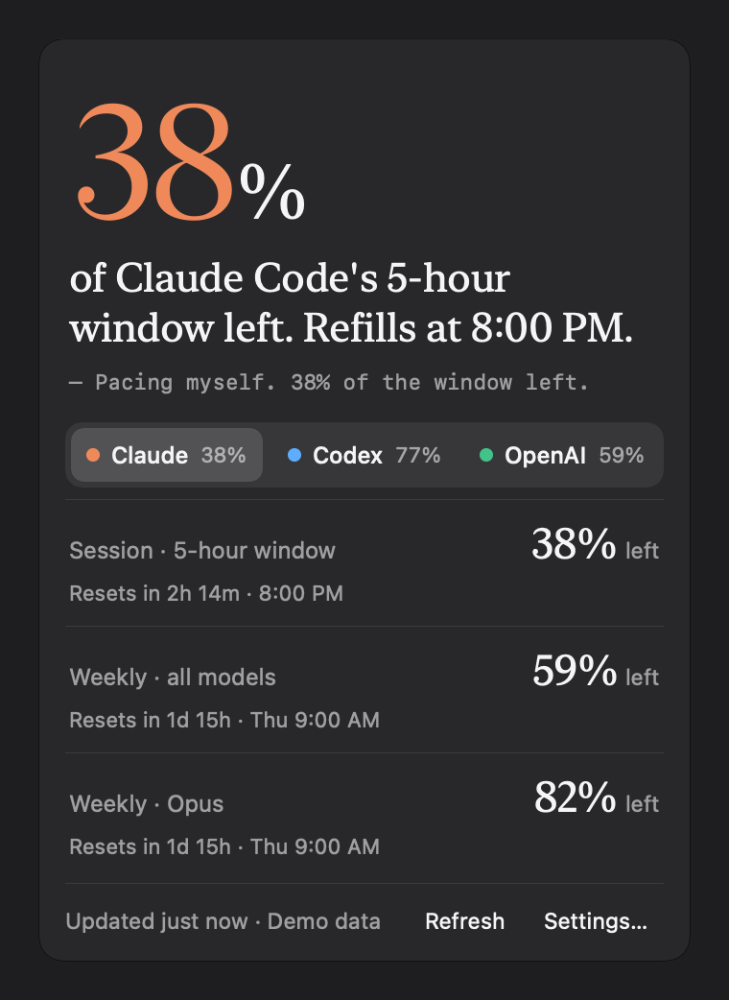
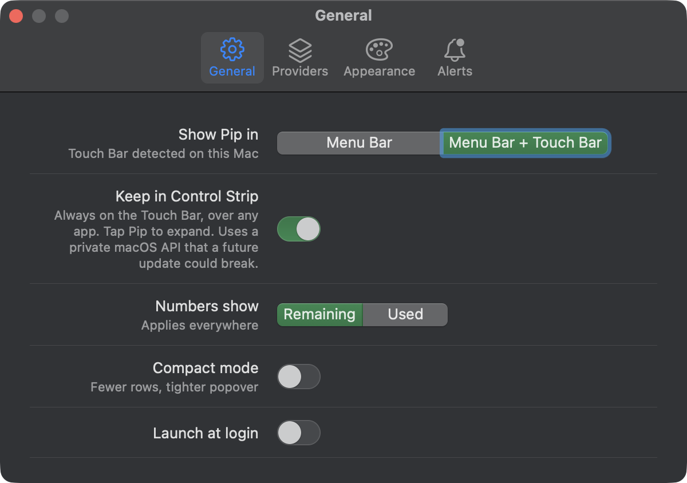

# Pip

Pip is a small slime who lives in your Mac's menu bar and keeps an eye on your AI usage. It shows how much of your Claude Code and Codex limits you have left, and what you've spent on the OpenAI and Anthropic APIs. Pip fills up and drains with your quota, gets sleepy while it waits for a reset, and cheers when a window refills.

Native macOS: Swift 6, SwiftUI and AppKit. No web view, no server, no dependencies.

<p align="center">
  
  
</p>

## What it shows

| Provider | What Pip reads | How |
|---|---|---|
| **Claude Code** | 5-hour session and weekly limits | The usage endpoint Claude Code itself calls, with the sign-in Claude Code already saved in your keychain. macOS asks you once to allow it. |
| **Codex** | 5-hour and weekly limits, credits | Pip asks Codex through `codex app-server`, the way Codex's own apps do. Pip never sees your token. |
| **OpenAI API** | Spend this month and requests | The documented Admin API (`/v1/organization/costs`, `/usage/completions`). Needs an Admin key. |
| **Anthropic API** | Spend this month and tokens | The documented Admin API (cost and usage reports). Needs an Admin key. |

Quotas, API spend and credits are kept as separate kinds of numbers and never mixed. Until you connect a provider, it shows clearly labelled demo data. If a source fails or changes, Pip shows it as offline rather than guessing.

> [!NOTE]
> The Claude Code and Codex sources are undocumented and could change without notice.

## A look around

**Menu bar.** Four styles (Companion, Energy, Type and Hybrid) and five layouts, from Pip alone to every provider at once.



**Moods.** Pip's face and shape follow your quota and connection.



**Other styles.** Energy uses bars; Type is all numbers.

<p>
  
  
</p>

**Touch Bar.** On MacBook Pros with a Touch Bar, Pip shows one box per provider. You can also keep Pip in the Control Strip, where you tap it to expand over any app. That option uses a private macOS API, so it's off by default and may stop working after a macOS update.


**Settings.**



## Battery and accessibility

- Pip animates the menu bar in short bursts (about one second in five) at 12 fps, and stops drawing the popover entirely when it's closed. It uses about 1–2% CPU when idle.
- Reduce Motion is respected. Animation can also be turned off in Settings.
- It follows light and dark mode, and every element has a VoiceOver label.

## Requirements

- macOS 13 Ventura or later
- To build: Xcode 16 or later (Swift 6)

## Build and run

```sh
git clone https://github.com/newtrn/pip.git
cd pip
scripts/build-app.sh      # builds build/Pip.app
open build/Pip.app
```

Pip has no Dock icon. Look for it in the menu bar. Open the app again to bring up Settings, then go to **Providers → Connect…** to switch a provider from demo data to your real account.

### Development

```sh
swift test                         # unit tests
swift run Pip --probe codex        # print what a real source returns (codex | claudeCode | openAIAPI | anthropicAPI)
swift run Pip --snapshot out/      # render popovers, menu bar, moods and Touch Bar to PNGs
```

More detail: [docs/ARCHITECTURE.md](docs/ARCHITECTURE.md) and [docs/PLAN.md](docs/PLAN.md).

## Privacy

- Pip has no server and no analytics.
- API keys are stored in your login keychain and sent only to the provider they belong to.
- Pip never renews or changes the Claude Code or Codex sign-in.

---

Pip isn't affiliated with Anthropic or OpenAI. Claude, Claude Code, Codex and ChatGPT are their owners' trademarks.
